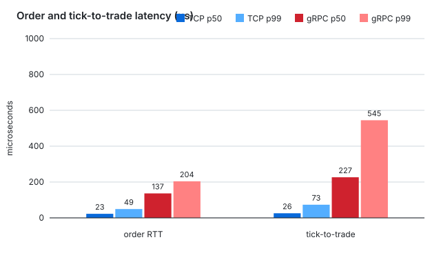
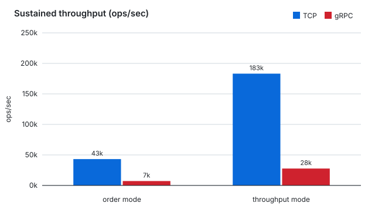
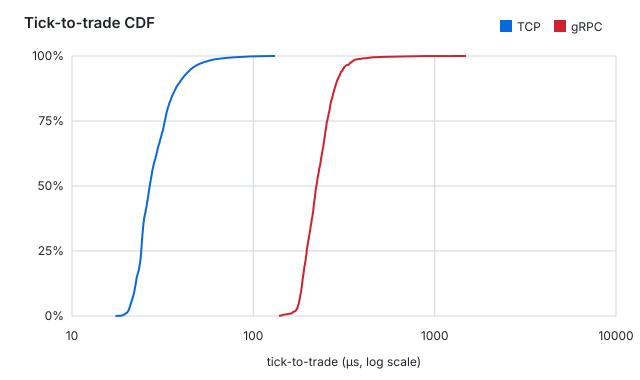

# Tick-to-trade latency lab

A mock electronic exchange in C++17 with two transports — raw TCP sockets and
gRPC — and a benchmark client that measures the metrics HFT interviews ask
about: **tick-to-trade latency, order-entry RTT, tail latency, and jitter**.

## The three skills, mapped to files

1. **Linux + networking** — `src/mock_exchange.cpp` is a single-threaded
   `poll()` event loop on raw POSIX sockets: accepts, partial reads/writes,
   framing, backpressure. No framework. `src/wire.h` is the binary protocol.
2. **Architecture** — a client ↔ exchange split with feed semantics borrowed
   from real venues: sequence numbers, gap detection, one ack per order,
   exchange-stamped timestamps.
3. **Benchmarking** — `src/hft_client.cpp` records full latency distributions
   (p50/p99/p999/max/stddev), not just means. `docs/PERF.md` walks the hot
   path with `perf` / flame graphs (Linux) and Instruments (macOS).

## Quickstart

TCP-only, zero dependencies:

```sh
make smoke   # build + loopback correctness checks
make bench   # full TCP benchmark -> results/summary.md
```

Full comparison (TCP vs gRPC). Needs CMake + protobuf + gRPC:

```sh
brew install cmake protobuf grpc        # macOS
cmake -S . -B build -DCMAKE_BUILD_TYPE=Release
cmake --build build -j
bash scripts/bench.sh build results     # -> results/summary.md
ctest --test-dir build                  # smoke via CTest
```

Linux (also the `perf` box): `docker build -t latencylab .` — see Dockerfile.

## What gets measured

| Mode | What the client does | Key metric |
|---|---|---|
| `order` | sequential NewOrder → Ack | order-entry RTT (p50/p99/max) |
| `tick2trade` | per tick: receive → send order → ack | tick_recv → ack_recv |
| `throughput` | pipelined orders, window in flight | max sustainable op/s |

`tick2trade` additionally reports the **order leg** (send → ack) and the
**one-way wire time** (exchange stamp → client receive — valid because both
sides share a clock on loopback), plus sequence-gap count. Same-host numbers
are a floor, not a prediction: production adds NIC, switch, and colo hops.

## Results

Apple M1 Pro, loopback, 2026-11-10 (microseconds unless noted):

| Benchmark | TCP p50 | TCP p99 | TCP max | TCP op/s | gRPC p50 | gRPC p99 | gRPC max | gRPC op/s |
|---|---|---|---|---|---|---|---|---|
| `order` | 22.6 | 49.2 | 124.8 | 43,186 | 136.7 | 203.9 | 1304.8 | 7,198 |
| `throughput` | 366.0 | 523.8 | 797.6 | 183,139 | 282.9 | 440.6 | 3118.8 | 27,687 |
| `tick2trade` | 25.9 | 73.3 | 1795.3 | 9,999 | 226.7 | 544.5 | 4198.2 | 1,467 |

Headline: order-entry RTT ~6×, tick-to-trade ~9×, sustained throughput ~7×
in favor of raw TCP. (Throughput-mode per-op latency looks close because the
two modes use different concurrency — pipelined window vs threads — so the
rate column is the comparison there; Little's law checks out on both.)

Full raw output: [results/summary.md](results/summary.md), regenerated by
`bench.sh` (CSVs alongside, no cherry-picking).





Charts and the tabular [results/summary.csv](results/summary.csv) render on
GitHub and regenerate from raw outputs with `python3 scripts/plot.py results`.
(Per-operation CSVs are alongside; `tcp_throughput.csv` exceeds GitHub's
512 KB table-render limit and is raw-only.)

## Layout

```text
src/mock_exchange.cpp    raw TCP exchange: poll loop, ticks + acks
src/hft_client.cpp       TCP bench client: order | tick2trade | throughput
src/grpc_exchange_server.cpp   same exchange over gRPC
src/grpc_hft_client.cpp        same benchmarks over gRPC
src/wire.h               binary protocol (frames, structs, clock helpers)
src/latency.h            latency histograms + percentile summaries
src/sys.h                portable core pinning
proto/exchange.proto     gRPC service definition
scripts/bench.sh         runs everything, writes results/summary.md
scripts/plot.py          regenerates results/*.svg + summary.csv from raw outputs
scripts/smoke.sh         correctness checks (also the CTest test)
docs/TRADEOFFS.md        why the hot path is raw TCP, and where gRPC wins
docs/PERF.md             hot-path methodology: perf, flame graphs, determinism
docs/HPC_TO_HFT.md       skill map for HPC engineers moving toward HFT
```

## Talking points (interview use)

- Why `TCP_NODELAY`, and what Nagle would do to p99.
- Why the server is single-threaded: no locks, no context switches, all state
  in one cache-warm core — and where that stops scaling.
- What `tick2trade` decomposes into, and which leg gRPC inflates most.
- Why loopback one-way measurement is valid here and what breaks across hosts
  (clock sync → PTP; see `docs/PERF.md`).
- Slow-consumer policy: bounded 64 MB queue, then drop. Real answer at scale:
  conflation or multicast with retransmit (moldudp-style).

## Natural extensions

Limit order book + matching engine in the exchange · multicast feed ·
`epoll`/`io_uring` (Linux) or `kqueue` (macOS) backend · `RDTSC`/`cntvct`
timestamping · lock-free SPSC queue between feed and strategy threads · SIMD
price parsing · FIX/ITCH protocol support.
